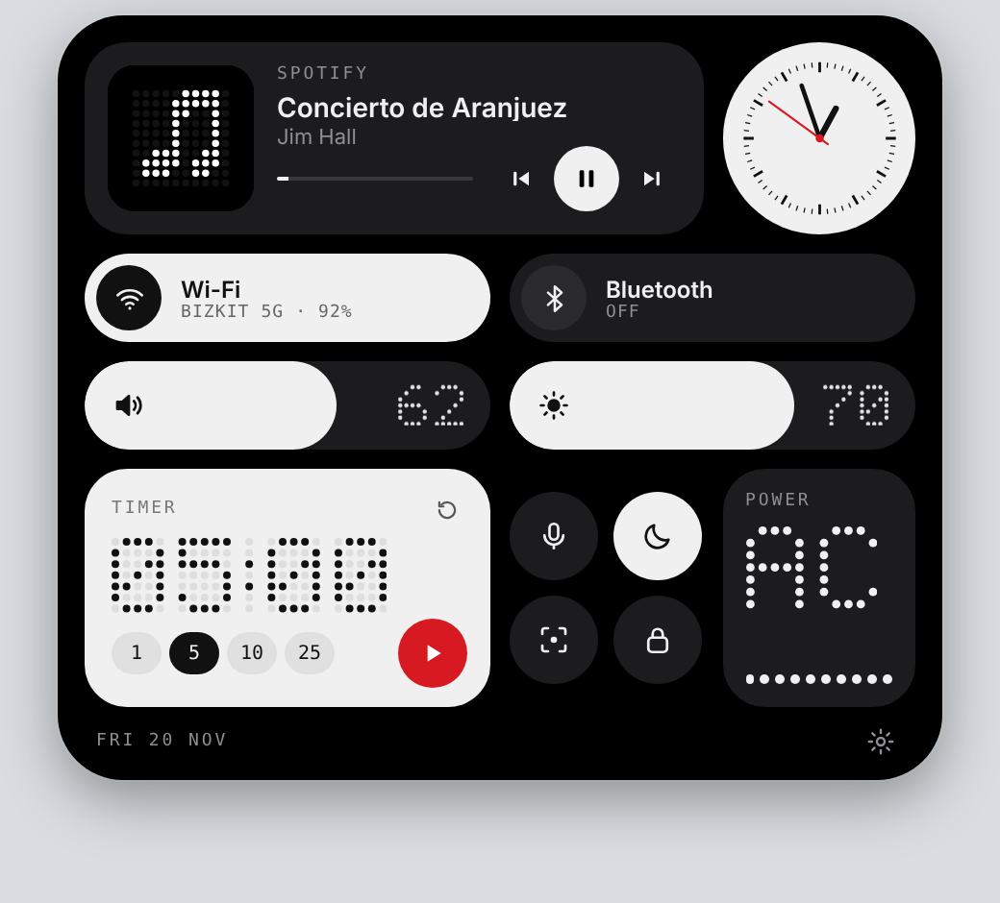

# Nothing Island — a Dynamic Island for Windows

**Built by Amith / Zevox**

> **Want the lowest RAM?** Use **`lite/`**. It's the same island as a ~150 KB native app with one process and roughly 15–30 MB of RAM, and it doesn't need Node.js. Just double-click `lite/build.bat`.

A black pill that lives at the top-centre of your screen, styled after Nothing OS
(dot-matrix numbers, white / black / red tiles). Click it to open the control panel.



## What it does
| Collapsed pill | Expanded panel |
|---|---|
| Clock + date when idle | Now playing (any app: Spotify, YouTube in Chrome/Edge, Media Player…) with dot-halftone album art, prev / play-pause / next, progress |
| Album art + dot equaliser while music plays | Wi-Fi: tap the icon = on/off, tap the rest = **network list** (switch, join with password, disconnect, forget) |
| Red timer countdown while a timer runs | Bluetooth: tap the icon = on/off, tap the rest = **paired devices** + *Add device* |
| Volume / brightness HUD when you change them with your keyboard | Volume slider + mute + **›** to pick the **sound output** (speakers / headphones / monitor), brightness slider |
| Red pulsing "TIME'S UP" alarm with beeps | Timer (1 / 5 / 10 / 25 min presets, scroll the digits to set minutes) |
| Notification peek (app, title, message) for WhatsApp, Gmail, Teams… | Mic mute, dark mode, screenshot, lock PC, battery, analog clock |
| Charging animation when you plug in / unplug | |
| Hides itself while a fullscreen game / video / presentation is open | |
| Scroll on the pill = change volume | |

**New:**
- **Mic / camera dot** — orange dot while any app uses your microphone, green while one uses your camera (like a phone's privacy dots), with a short peek naming the app. Hover the island to see which apps.
- **Next meeting** — paste your calendar's secret ICS link in ⚙ (gear) → *Calendar*. The pill shows `• STANDUP 12M` from 15 minutes before, the time left while it's on, and pops up at 5 minutes and at start with a **JOIN** button for Meet / Zoom / Teams links.
- **Month calendar** — tap the date tile or the agenda. Browse months, see your linked calendar's events (dots), **add** your own events (time + length or all-day), **remove** them, and **mark** days (red dot). Your own events also count down on the pill like meetings. They're stored only on this PC (`calendar-local.json`). Events from a linked Google/Outlook link are read-only here.
- **Wi-Fi picker** — on Windows 11 24H2+, Windows only lists nearby networks to apps with location access; if you see that message, tap *Open location settings* and turn on “Let desktop apps access your location”.
- **Bluetooth** — shows paired devices and whether they're connected. Windows doesn't let other apps connect/disconnect a paired device directly, so tapping one opens Bluetooth settings; *+ Add device* opens Windows' pairing window.
- **Gestures** — swipe the pill left = next track, right = previous, hold = play/pause, two-finger trackpad swipe works too. A "now playing" peek shows the new song.

Two styles: **Island** (floating pill, like iPhone's Dynamic Island) and **Notch** (attached to the top edge, like a MacBook notch). Switch with the ISLAND/NOTCH button in the panel's bottom-right or from the tray menu; your choice is remembered.

Shortcuts: **Ctrl + Alt + Space** opens/closes it. **Esc** closes. Tray icon (bottom-right) has
*Show island*, *Start with Windows* and *Quit*.

## Run it
Needs Windows 10/11 and [Node.js LTS](https://nodejs.org).

```
npm install
npm start
```
…or just double-click `start.bat`. It installs on first run, starts the island and closes its own window straight away.
After that you can use **`Nothing Island.vbs`**, which starts it with no window at all. It's good for a desktop shortcut. You can also turn on *Start with Windows* from the tray.

Build an .exe (portable + installer, output in `dist/`):
```
npm run dist
```

## How it works
- `main.js` — Electron window: frameless, transparent, always-on-top, click-through except over the island.
- `bridge.ps1` — one long-running Windows PowerShell process that talks to Windows:
  Core Audio (volume, mute, mic), the system media session (now playing + controls),
  the Radios API (Wi-Fi / Bluetooth on-off), WMI (brightness), registry (dark mode).
  No admin rights needed.
- `renderer/` — the UI. `dotmatrix.js` draws the dot-matrix type and halftone album art.

## Notes
- **Brightness** works on laptop/built-in screens. External monitors show "N/A" (Windows doesn't expose them through WMI).
- **Wi-Fi name**: on Windows 11 24H2+ the SSID may need *Location services* switched on; otherwise it shows "NOT CONNECTED" even while online. Toggling still works.
- If Wi-Fi/Bluetooth say "CAN'T TOGGLE", Windows blocked it (e.g. airplane mode or a company policy). Right-click opens Settings instead.
- **Notifications** are read from Windows' own notification history on your PC (read-only, nothing leaves the PC). They work in any language, even with banners off. If the history can't be read, the app falls back to reading the pop-up on screen. Click a notification to dismiss it; hover to keep it open.
- **Camera dot** needs a webcam that Windows can see. The diagnostics report lists any it finds under `webcamDevices`.
- **Fullscreen**: the island hides automatically and comes back when you leave fullscreen. A finished timer still shows.

## Memory use
- **Native engine:** on first launch the app compiles `bridge.cs` into a small helper (`NothingIslandEngine.exe` in your AppData) using the C# compiler that's built into Windows, so you don't need to install anything. It replaces the PowerShell helper, which was the biggest memory user. If compiling fails, it uses PowerShell automatically, and `engine\build-error.log` explains why.
- **Low-memory mode** (on by default): no separate GPU process, one renderer, no disk cache, limited JavaScript memory, and media-key and other unused Chromium services turned off.
- **While collapsed and idle:** about once a minute the app asks Windows to page out memory it isn't using. Hidden parts of the panel aren't drawn, album art is kept as a tiny 96px copy, the alarm's audio is released after it rings, and system checks slow down when you're not touching it.
- **Tray menu:** *Use native engine* and *Low-memory mode* can be switched off if anything misbehaves. If the island ever shows a black box instead of a transparent background, turn off low-memory mode.

## Security
- The UI runs sandboxed with context isolation, no Node access and a strict Content-Security-Policy. It can't navigate, open windows or request permissions.
- The UI can only ask for a fixed list of system actions, and every value is checked: volume 0–100, Wi-Fi/Bluetooth On/Off, Windows Settings pages only.
- Wi-Fi: only networks that are in range right now can be joined; the name and password are checked (length, no control characters) and XML-escaped. The password goes straight to Windows' Wi-Fi API (which stores it encrypted) — it is never written to a file or a log.
- Sound output: only a device id the engine has just listed can be selected.
- Calendar: added events are length- and date-checked, and only your own events can be removed.
- **JOIN** only opens a link that is in one of your calendar events and points to Meet, Zoom, Teams, Webex, Whereby or Jitsi.
- Your secret calendar link is encrypted with Windows (DPAPI) in `settings.json`, never stored as plain text. The download has a 20 s timeout and a 10 MB limit, and only accepts https.
- PowerShell, netsh and rundll32 are started from their full `C:\Windows\System32` paths, so a fake `powershell.exe` in another folder can't be picked up.
- After `npm install`, run `npm audit`. Warnings that come only from `electron-builder` (the tool that builds the .exe) don't ship inside the app.

## Mic / camera dot not showing?
Right-click the tray icon → **Copy mic/camera diagnostics**, then paste the result to whoever is helping you.
The mic is detected from Windows' live audio sessions. The camera is detected from Windows' privacy usage records (the same data behind *Settings → Privacy → Camera → Recent activity*).
